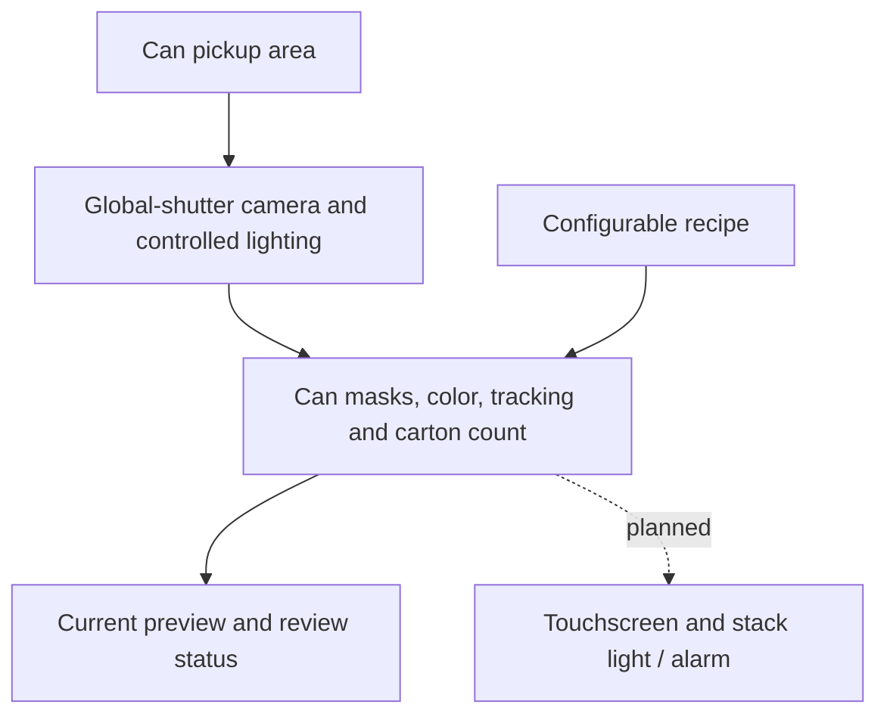

# Yards Brewing Variety-Pack Inspection

CS488 Capstone Project, Team 1

Penn State Abington

Industry partner: Yards Brewing Company

We are working with Yards Brewing Company to reduce errors in their variety-pack packaging process. Our goal is to check that each carton receives the correct varieties and quantities of cans, so an incorrect mix can be caught before the carton is finished.

Yards produces individual beer varieties separately, then brings them together at a manual variety-pack station. Workers open the original cases, place each variety in its own conveyor lane, select the cans, and load them into reused cartons. The common configuration we have been working with is three varieties with four cans each, for a total of twelve cans. Because the combinations can change, our system needs to support different required colors and quantities.

## Our current approach

We initially explored automating can dispensing and carton loading with gates, sensors, guides, and a pusher. Through our research and visits to Yards, we developed those ideas further and tested a simplified gate mechanism on a toy conveyor. We have since narrowed our current scope to camera verification and operator alerts before manual packing. Our [earlier designs](archive/old-design/README.md) show how we arrived at this direction.

We use a trained can-instance segmentation model, OpenCV color analysis and a cumulative count for one carton. We assume that confirmed cans in the active camera area go into the carton, and subtract a counted can only when we observe it crossing the separate left defect line. Carton placement itself is not verified.

Our camera prototype runs on a Windows laptop and on a Raspberry Pi 5 with a Hailo-8 AI HAT+ 26 TOPS. We use a global-shutter USB camera and a controlled pickup view. The Windows program runs the model through PyTorch; the Pi runs a compiled Hailo model and performs the remaining image analysis in Python/OpenCV. Lane-specific product checks and the station hardware connections remain future work.

We plan to show a green stack light when the inspection passes, and a red light with an alarm when the operator needs to correct an incorrect mix. A touchscreen HMI will display the inspection status and provide operator controls. The prototype currently displays its counts and status on the computer screen.

Our [technical and functional requirements](docs/requirements/New%20Technical%20Requirements%20%26%20Functional%20Requirements.docx) explain the expected behavior, and our [software and defect requirements](docs/design/Software%20and%20Defect%20Requirements.docx) describe how we plan to process the images and identify an incorrect pack.

## Camera software

The [software overview](vision/README.md) separates the current [Windows counter](vision/windows/README.md), [Raspberry Pi runtime](vision/pi/README.md) and [earlier color-only prototype](vision/legacy/color_baseline/README.md). A fresh checkout includes the two selected model files, example configuration and setup instructions. Our private recordings and experiment folders stay local.

The [development history](vision/docs/development-history.md) records the progression from HSV regions to can masks, fine-tuning, temporal counting and Hailo deployment. The [architecture guide](vision/docs/architecture.md) identifies the code for each stage. Our [test plan](vision/docs/testing.md) and [validation notes](vision/docs/validation.md) distinguish controlled results from the production checks still needed.

## Where we are now

We have completed initial research and site visits, trained and adapted a small can model, and run the current counter on the laptop and Pi. One controlled Pi trial counted a complete twelve-pack correctly as six pairs. An earlier trial exposed an extra admission and color/identity uncertainty, so one successful pack does not establish production reliability.

Our next steps are to:

- Repeat complete packs with singles, pairs and four-can groups at the observed production pickup speed.
- Check camera placement, lighting and defect removal across operators and label poses.
- Measure throughput without diagnostic image saving and investigate identity/color failures that recur.
- Connect inspection results to the stack light and operator interface.
- Complete the bill of materials and evaluate the installed station at Yards.

Our [timing notes](vision/docs/validation.md) identify the hardware and recording mode for each measurement. The design documents and [October presentation](presentations/Module%202%20Progress%20Report%20Team%201.pptx) remain part of the project record.

## Project files

| Section | What we keep here |
|---|---|
| [docs/requirements](docs/requirements/README.md) | Our current inspection requirements and the questions we used during discovery |
| [docs/design](docs/design/README.md) | Software and defect requirements, bill of materials, and timing/performance work |
| [docs/research](docs/research/README.md) | Research into Yards' processes, camera options, and possible solutions |
| [docs/meetings/yards](docs/meetings/yards/README.md) | Questions, notes, and transcripts from our meetings and visits |
| [docs/meetings/scrum](docs/meetings/scrum/README.md) | Our weekly progress, plans, blockers, and retrospectives |
| [docs/team](docs/team/README.md) | Our team contract and meeting availability |
| [docs/templates](docs/templates/README.md) | The blank template we use for scrum logs |
| [presentations](presentations/README.md) | Our progress presentations and presentation feedback |
| [vision](vision/README.md) | Current Windows/Pi counters, shared implementation, selected models, setup, tests and development history |
| [media](media/README.md) | Photos and audio from our research and visits to Yards |
| [media/videos](media/videos/README.md) | Links to the videos from our October 7 visit |
| [archive/old-design](archive/old-design/README.md) | Our earlier mechanical and controls designs |

We keep the larger videos in our shared OneDrive folder, with links in the [video index](media/videos/README.md). Access requires the team's existing Penn State/OneDrive permissions. Our [meeting notes and transcripts](docs/meetings/yards/README.md) provide a written reference for those discussions.

## Team

- Jonathan Alavez Reyes
- Faahil Ali
- Liya Aji
- Margaret Decker
- Sabrina Abdukadirova
