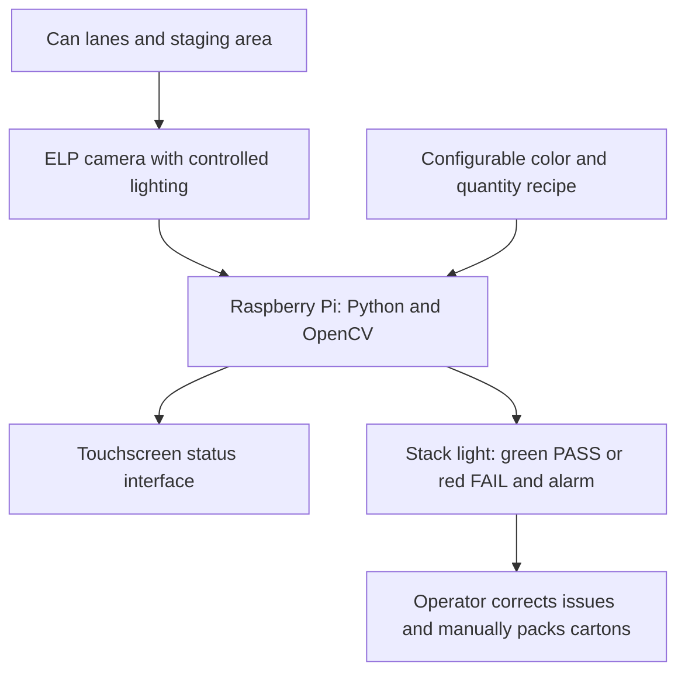

# Yards Brewing Variety-Pack Inspection

CS488 Capstone Project, Team 1

Penn State Abington

Industry partner: Yards Brewing Company

We are working with Yards Brewing Company to reduce errors in their variety-pack packaging process. Our goal is to check that the correct varieties and quantities of cans are present before workers load them into a carton, so an incorrect mix can be caught while it is still easy to fix.

Yards produces individual beer varieties separately, then brings them together at a manual variety-pack station. Workers open the original cases, place each variety in its own conveyor lane, select the cans, and load them into reused cartons. The common configuration we have been working with is three varieties with four cans each, for a total of twelve cans. Because the combinations can change, our system needs to support different required colors and quantities.

## Our current approach

We initially explored automating can dispensing and carton loading with gates, sensors, guides, and a pusher. Through our research and visits to Yards, we developed those ideas further and tested a simplified gate mechanism on a toy conveyor. We have since narrowed our current scope to camera verification and operator alerts before manual packing. Our [earlier designs](archive/old-design/README.md) show how we arrived at this direction.

Our current design uses an ELP global-shutter camera and controlled lighting to view the cans near the packing area. A Raspberry Pi running Python and OpenCV will compare the detected colors and quantities with the selected recipe, including checking that each lane contains the expected variety.

When the arrangement passes inspection, a stack light will show green. If the system detects an incorrect arrangement, it will show red and sound an alarm so the operator can correct the problem before packing. We also plan to use a touchscreen HMI to display the inspection status and provide operator controls.

Our [technical and functional requirements](docs/requirements/New%20Technical%20Requirements%20%26%20Functional%20Requirements.docx) explain the expected behavior, and our [software and defect requirements](docs/design/Software%20and%20Defect%20Requirements.docx) describe how we plan to process the images and identify an incorrect pack.

## Where we are now

We have completed our initial research, visited Yards to observe the process, and developed several prototype and design concepts. We are now working through the details needed to test the inspection system with the actual cans and lighting conditions.

Our next steps are to:

- Confirm the camera position and lighting so the cans are consistently visible.
- Test color detection and counting against different variety-pack recipes.
- Decide how the system should respond when an image is unclear or a can cannot be identified.
- Connect the inspection result to the stack light and operator interface.
- Complete the bill of materials and measure the system's timing and reliability.

We are still filling in the timing and performance design and completing parts of our [October design presentation](presentations/Module%202%20Progress%20Report%20Team%201.pptx).

## Project files

| Section | What we keep here |
|---|---|
| [docs/requirements](docs/requirements/README.md) | Our current inspection requirements and the questions we used during discovery |
| [docs/design](docs/design/README.md) | Software and defect requirements, bill of materials, and timing/performance work |
| [docs/research](docs/research/README.md) | Research into Yards' processes, camera options, and possible solutions |
| [docs/meetings/yards](docs/meetings/yards/README.md) | Questions, notes, and transcripts from our meetings and visits |
| [docs/meetings/scrum](docs/meetings/scrum/README.md) | Our weekly progress, plans, blockers, and retrospectives |
| [docs/team](docs/team/README.md) | Our team contract and meeting availability |
| [docs/templates](docs/templates/README.md) | The blank template we use for scrum logs |
| [presentations](presentations/README.md) | Our progress presentations and presentation feedback |
| [vision](vision/README.md) | Camera/software setup notes from our early testing |
| [media](media/README.md) | Photos and audio from our research and visits to Yards |
| [media/videos](media/videos/README.md) | Links to the videos from our October 7 visit |
| [archive/old-design](archive/old-design/README.md) | Our earlier mechanical and controls designs |

We keep the larger videos in our shared OneDrive folder, with links in the [video index](media/videos/README.md). Access requires the team's existing Penn State/OneDrive permissions. Our [meeting notes and transcripts](docs/meetings/yards/README.md) provide a written reference for those discussions.

## Team

- Jonathan Alavez Reyes
- Faahil Ali
- Liya Aji
- Margaret Decker
- Sabrina Abdukadirova
