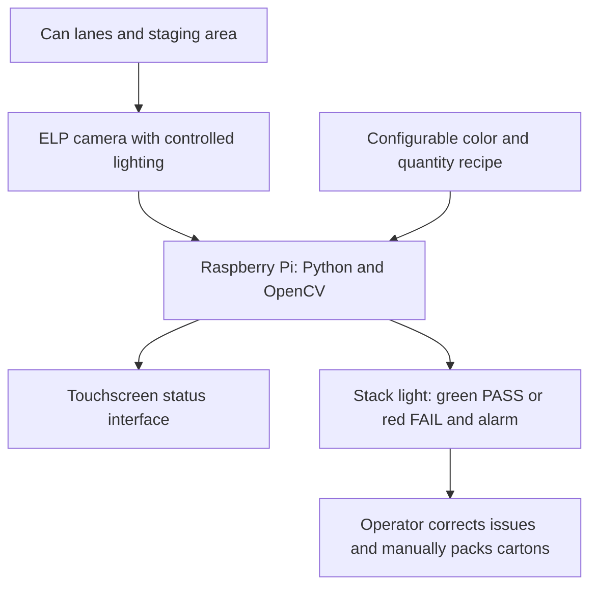

# Yards Brewing Variety-Pack Inspection

**CS488 Capstone — Team 1, Penn State Abington**

Industry partner: **Yards Brewing Company**

Documentation snapshot: **October 13, 2026**

Team 1 is developing a camera-based quality check for Yards' variety-pack station. The system is intended to verify the selected can varieties and quantities before employees manually load the cartons, reducing incorrect mixes and counting errors.

The current documented scope comes from the [October 13 technical and functional requirements](docs/requirements/New%20Technical%20Requirements%20%26%20Functional%20Requirements.docx) and [software/defect design](docs/design/Software%20and%20Defect%20Requirements.docx). Earlier work explored automatic dispensing and carton loading. Those concepts remain available in the [design archive](archive/old-design/README.md) and dated meeting records.

## Current inspection design

Yards produces individual beer SKUs separately, then combines them at the variety-pack station. Employees place each SKU in its lane, select the required cans, load reused cartons, and seal the packs. The common configuration discussed in the project is **three varieties with four cans each**, totaling twelve cans. Required colors and quantities should be configurable for other recipes.

The proposed inspection system uses:

- An **ELP global-shutter camera** with controlled lighting to view the cans near the packing area.
- A **Raspberry Pi running Python/OpenCV** to identify colors, check quantities and lane consistency, and determine PASS or FAIL.
- A proposed **touchscreen HMI** for inspection status and operator interaction.
- A **stack light** showing green for PASS and red with an audible alarm for FAIL.
- **Operator correction and manual carton packing** after inspection.

This is a design proposal. Camera placement, lighting, color thresholds, ambiguous-image handling, and performance still require validation. The [October design presentation](presentations/Module%202%20Progress%20Report%20Team%201.pptx) includes hardware and mounting concepts alongside unfinished slides.

## Start here

1. Read the [current requirements](docs/requirements/README.md) and [inspection design](docs/design/README.md).
2. Review [Yards meeting and visit records](docs/meetings/yards/README.md) for observations and partner feedback.
3. Use the [research collection](docs/research/README.md) for background and the development of earlier concepts.
4. Browse [photos/audio](media/README.md), [video links](media/videos/README.md), and [progress presentations](presentations/README.md) for supporting evidence.

## Repository guide

| Section | What belongs here |
|---|---|
| [docs/requirements](docs/requirements/README.md) | Current inspection requirements and earlier discovery questions |
| [docs/design](docs/design/README.md) | Software/defect design, draft bill of materials, and timing/performance draft |
| [docs/research](docs/research/README.md) | Domain research, two distinct portfolios, and early reference transcripts |
| [docs/meetings/yards](docs/meetings/yards/README.md) | Partner meeting preparation, findings, and visit transcripts grouped by date |
| [docs/meetings/scrum](docs/meetings/scrum/README.md) | Team progress, plans, blockers, and retrospectives |
| [docs/team](docs/team/README.md) | Team contract and meeting availability |
| [docs/templates](docs/templates/README.md) | Reusable blank scrum-log blueprint |
| [presentations](presentations/README.md) | September and October progress decks plus presentation feedback |
| [vision](vision/README.md) | Earlier Windows/YOLO setup reference and links to the current vision design |
| [media](media/README.md) | Original discovery/visit photos and September 4 audio |
| [media/videos](media/videos/README.md) | Individual OneDrive links to the eight October visit videos |
| [archive/old-design](archive/old-design/README.md) | Earlier mechanical/PLC/gating/pusher concepts and their requirements |
| [docs/import](docs/import/README.md) | Complete OneDrive inventory, source-to-repository mapping, and file hashes |

## Status and open work

The imported materials document research, partner discussions, prototype exploration, and design planning. Scrum logs describe a toy-conveyor/servo prototype, but the OneDrive folder contains no standalone implementation source or test-result package to import.

| Artifact | Status in this snapshot |
|---|---|
| Current requirements | Documented inspection and alert behavior; requires implementation and validation |
| Software/defect design | Draft with open comments about confidence and unidentifiable cans |
| Bill of materials | Draft estimates; several links, vendor details, and a cost remain incomplete |
| Timing/performance design | Title-only draft; no measured timing or throughput results |
| October progress presentation | Partial draft with placeholders and unfinished sections |
| Scrum log 7 | Weekly form with roles filled in; member updates still blank |
| Development/testing and deployment folders | Empty in the OneDrive snapshot |

The earlier design combined double-gate escapements, sensors/PLC control, guides, camera validation, and a carton-loading pusher. Its documents remain useful project history, while the October 13 requirements define the narrower inspection/alert baseline used here. Older portfolios and scrum logs should be read in their original time context.

## Files and access

The recursive OneDrive inventory contains **59 files**. This repository includes **51 files**: **46 unchanged originals** and **5 copies with contact information removed from content or review metadata**, as requested for this public repository. Original filenames are preserved within the organized folders.

The **8 original videos remain in OneDrive** with individual links in the [video index](media/videos/README.md). Those links require the existing Penn State/OneDrive permissions. The [import record](docs/import/README.md) and [machine-readable manifest](docs/import/file-manifest.json) account for every source file, including the video links and two empty source folders.

Open Word and PowerPoint files in compatible applications. The photos retain their original HEIC/JPEG formats; HEIC files may need a compatible viewer. This documentation import does not include a runnable vision application, model weights, or a software installation procedure.

For future work, add implementation files to the appropriate subsystem, keep current requirements separate from superseded designs, and update the relevant section README when adding or replacing an artifact. Keep virtual environments, caches, credentials, and temporary renders out of Git.

## Team

- Jonathan Alavez Reyes
- Faahil Ali
- Liya Aji
- Margaret Decker
- Sabrina Abdukadirova

Penn State Abington IT/CMPSC Capstone Team 1, in collaboration with Yards Brewing Company.
