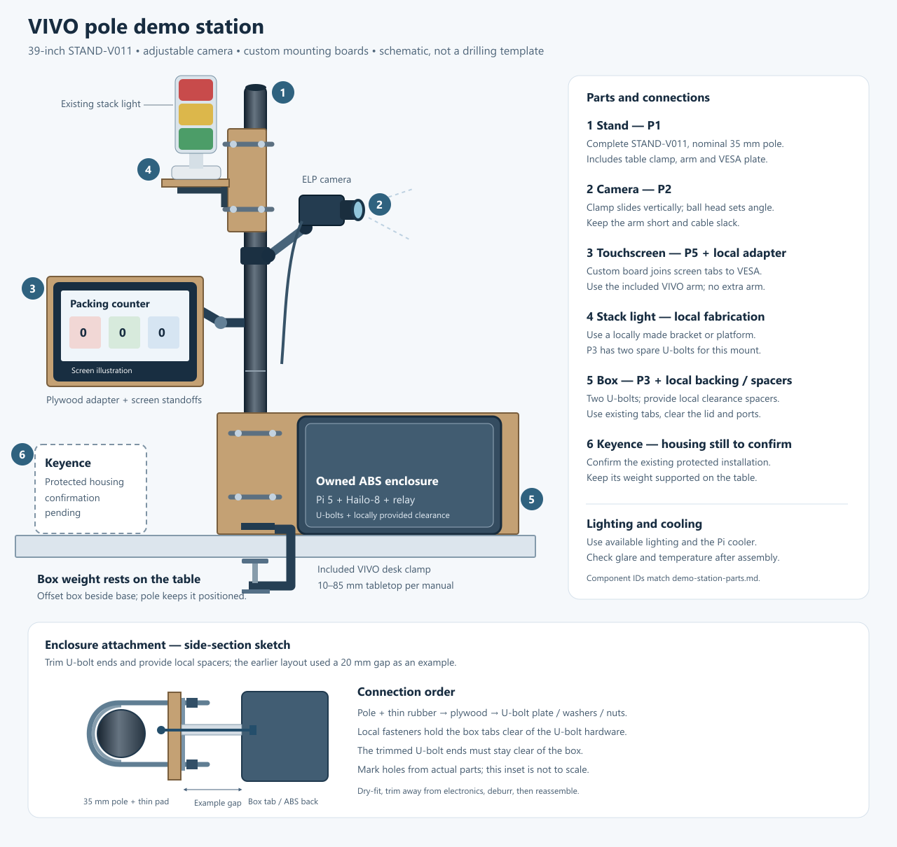

# Demo station: minimum VIVO pole shopping list

Updated November 5, 2026. The Amazon order is limited to the five items below. Tools, plywood, general screws/nuts/washers, standoffs/spacers and stack-light mounting hardware will be supplied or obtained locally. Wooden can-lane materials are outside this list.

## Buy these items

| ID | Item / Amazon link | Buy quantity | Observed total | Use / fit |
|---|---|---|---:|---|
| P1 | [VIVO STAND-V011, complete 39-inch stand, desk clamp and monitor arm](https://www.amazon.com/dp/B01BO42XK0) | 1 | $43.99 | Includes the table clamp, screen arm, VESA plate and cable clips. |
| P2 | [SmallRig adjustable camera clamp / ball-head arm](https://www.amazon.com/dp/B00DJ5XH4O) | 1 | $14.99 | Fits the nominal 35 mm pole; 1/4-20 screw matches the linked ELP camera socket. |
| P3 | [ZYUAROM ROUND U-bolts with plates, nuts and washers](https://www.amazon.com/dp/B0FWHSJWZX) | 1 four-set kit | $16.99 | Two sets for the enclosure backing; the other two can be used for the locally made stack-light mount or kept as spares. Drawing shows approximately 40 mm inner width and 90 mm inner reach. |
| P4 | [Solid neoprene padding, 12 x 12 inches, 1/16-inch thick](https://www.amazon.com/dp/B0BKQRN7S6) | 1 sheet | $6.89 | Cut thin contact pads. Adds grip and protects the pole; it does not reduce friction. Use one layer rather than thick foam. |
| P5 | [Hosyond 7-inch 1024 x 600 HDMI touchscreen](https://www.amazon.com/dp/B09XKC53NH) | 1 | $45.99 | Includes HDMI cable, Micro-HDMI adapter, Micro-USB touch cable and mounting hardware. Attach to the VIVO arm through a locally made adapter. |

**Total: $128.85 before tax and shipping.** Prices are from the product checks and can change. No tools, general fastener assortments, plywood packs, shelf brackets, separate standoff kits, extra screen arms, accessory lights, fans, chargers or longer cables are included in this order.

## Provide locally

These parts are still needed for assembly; they have been removed from the online order because they will be provided locally.

| Assembly | Local materials / work |
|---|---|
| Touchscreen adapter | A rigid plywood or equivalent adapter between the screen's corner tabs and the VIVO VESA plate. Use the actual screen and plate to mark the holes; the display is not a direct VESA fit. Leave the electronics and HDMI/USB plugs clear. Use the screen's supplied hardware where suitable, plus locally sourced matching screws/spacers as needed. |
| Enclosure attachment | A rigid backing board or equivalent mounting plate, two P3 U-bolts, matching local fasteners and enough spacing to clear their nuts/ends. The previous layout used an approximately 18 x 10 inch, 12 mm plywood backing with 20 mm box spacers; those dimensions are an example, not a mandatory purchase. Offset the enclosure beside the VIVO base and keep its bottom resting on the table. |
| Stack-light attachment | A locally fabricated bracket, platform or adapter that securely supports the existing white mounting foot. Two P3 U-bolts are available if useful. The purchased four-inch shelf brackets are removed. Final bracket geometry will be determined during assembly. |
| Pi and relay inside the ABS box | Existing mounting plate, proper board spacers and matching screws through the boards' existing holes. Keep the Pi cooler, HAT spacers and PCIe cable arrangement. Keep the circuit boards clear of the mounting plate and fasteners. |
| Cable routing | Existing camera cable, the screen's included cables, available ties/clips, edge protection and cable restraint where cables enter the box. Check reach before locating the boards. |
| Lighting and cooling | Use available lighting and retain the Pi's processor cooling. Check glare, image quality and temperatures with the final enclosure closed. Additional accessories can be selected later if testing shows a need. |
| Tools and ordinary fasteners | Supplied locally; no online tool or fastener-kit purchase. Select bolt length against the actual board, bracket, spacer, washer and nut stack. |

## Fit and assembly notes

- Order the **complete VIVO STAND-V011 (B01BO42XK0)** rather than a replacement pole alone. Its assembly manual specifies **10–85 mm tabletop thickness** for clamp mounting, with flat, clear contact above and below the table edge.
- VIVO lists **35 mm round poles** for its compatible STAND-V011 cable-clip family. P2 opens to 54 mm. P3's drawing shows about 40 mm internal width, which leaves space for thin padding around the nominal pole diameter.
- P3 is a **round-bend** kit, replacing the earlier square U-bolt link. Use its supplied matching nuts, plates and washers.
- Keep two vertically separated attachment points on the enclosure backing. Do not let U-bolt hardware press against the ABS box. Dry-fit, trim excessive U-bolt ends away from electronics, deburr and provide sufficient clearance using locally available rigid spacers or a suitable alternative layout. The drawing's 20 mm gap is one example.
- The stack light's original foot still needs a mechanically secure adapter or platform. Final fabrication is local; no purchased shelf-bracket design is assumed.
- The rubber helps **increase grip and protect the finish**. Avoid thick soft foam that can compress and allow movement.
- Keep the camera arm short and leave slack in the camera cable. Check whether touching the screen moves the image before fixing the final camera position.
- The Pi continues to use its own USB-C supply. The existing Keyence 24 V supply is for the stack-light circuit.
- The five purchases can support the proposed prototype **with the local materials and fabrication above**. They are not a complete assembly without those locally supplied parts.

Sources: [VIVO stand](https://vivo-us.com/products/stand-v011), [VIVO assembly manual](https://cdn.shopify.com/s/files/1/1190/2562/files/STAND-V011_Series_REV2L_online.pdf?v=1733427125), [VIVO compatible 35 mm pole clips](https://vivo-us.com/products/pt-sd-wc05c), [ELP camera listing](https://www.amazon.com/dp/B0H2TT4TGL), and the linked product listings.

## Power-supply housing

The Pi and relay can be mounted in the existing ABS enclosure with proper board spacing. The **Keyence MS2-H100 needs a separate housing decision**: the manufacturer's MS2 installation instructions call for a conductive enclosure with IP54 or higher, protective earthing and specified clearances. The existing plastic box, even with a metal mounting plate inside, is not that conductive enclosure.

Keep the Keyence in an appropriate protected metal housing, or use an appropriate overall metal enclosure if one is supplied locally. Do not treat the five-item order as resolving its mains housing. No new housing or mains fittings are included in this budget; the existing protected installation still needs confirmation.

The MS2-H100 mounting drawing specifies nominal M3 holes with a maximum 4 mm screw insertion into the supply. Long general-purpose mounting screws must not be driven into it. Have the lab technician check its housing, mains entry, grounding and clearances. [KEYENCE MS2-series installation manual](https://www.artisantg.com/info/Keyence_MS2_H50_Manual_2021914121847.pdf).

## Layout reference

[Open the editable layout](demo-station-layout.svg)

The sketch illustrates one arrangement. Wood, screen adapters, spacers and light mounting parts shown in it are locally supplied or fabricated. The stack-light mounting method remains to be finalized during assembly; the illustration is not an instruction to order shelf brackets.

