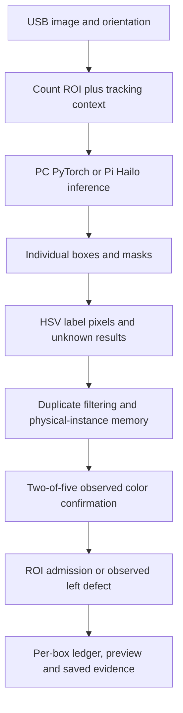

# How the current counter works

Our Python application combines a can-instance model with OpenCV color analysis and a persistent carton ledger. The model predicts `can`, not a beer name or a red/green/blue class. Those colors are determined from pixels inside each predicted can mask.

## Entry points and responsibilities

| Component | Actual code |
| --- | --- |
| Windows camera, O/D geometry controls, trial lifecycle and rendering | `windows/run.py` |
| Windows model prediction and contour display | `windows/detector.py` |
| Pi capture, Hailo backend selection, rendering and timing | `pi/run.py` |
| HailoRT streams / optional ONNX verification backend | `pi/yardspi/backends.py` |
| Raw-head reconstruction, box NMS and instance masks | `pi/yardspi/decoding.py` |
| Pi stage orchestration | `pi/yardspi/pipeline.py` |
| HSV votes, duplicate masks, tracking, confirmation, ledger and defect rules | `common/`, documented in its [file map](../common/README.md) |

The Pi's central call is `row, masks = pipeline.process(frame, now)`. The frame is an oriented BGR image. The returned row includes observations, confirmed identities/colors, counts, reviews, events and timing. Returned display masks are cropped to the count ROI. Color classification happens earlier on the context masks.

## Images, model input and masks

The camera source is 1280×720. The count ROI excludes waiting stock; a surrounding crop with approximately 20% padding supports tracking near its edges. A can's box center establishes ROI membership. A mask touching the yellow edge is not necessarily clipped at the physical camera edge, because the larger context can still see it.

The Pi letterboxes the crop to 320 high × 640 wide and converts BGR to RGB. The HEF accepts NHWC RGB values in 0–255; division by 255 is already in the compiled network. The ONNX verification path uses NCHW values in 0–1. Double normalization would change predictions.

The model exposes ten raw heads: three box heads, three score heads, three per-can mask-coefficient heads and a shared prototype tensor. The Pi decoder applies the 0.50 confidence cutoff, box NMS at 0.70 IoU and native mask reconstruction. Masks return to the original crop coordinates before OpenCV samples label color. Host FLOAT32 outputs are dequantized INT8 results, not recovered original floating-point inference.

Both programs have masks and boxes. Windows draws the can contour with `findContours` / `drawContours`. The Pi currently draws a transparent mask fill and rectangle without that outline stroke. Fill is limited to the count ROI; boxes may extend into the context. Changing the outline display does not change segmentation or color analysis.

## Colors, identity and counting

HSV classification samples the mask interior to reduce rim/finger/background contamination. A color needs 25 pixels, 10% sampled coverage and 60% of the colored votes. Otherwise it stays unknown. Silver tops, white printing and poor visibility may leave insufficient evidence. Green artwork on a blue label can also matter when only a fragment is visible.

The duplicate filter collapses nearly identical same-color masks within one image: at least 95% containment and a 0.60 minimum area ratio. It does not deduplicate a can across different images.

ByteTrack suggests raw tracker identities. Our physical-instance memory performs one-to-one association using motion, overlap, color and those hints. It reconnects short losses within 0.65 seconds and ten processed frames. It requires two matching known-color observations with a unique leading known color in the last five processed frame indices; motion predictions and missing frames do not add hits. Lower processed FPS makes that evidence arrive farther apart.

The active area is to the right of the left defect line. A confirmed instance actually seen there counts once. A 0.40-second grace period permits confirmation to finish in context after leaving the ROI. No packaging boundary crossing is required. We assume placement into the carton. Only continuously observed movement to the left defect side subtracts a counted can. A first appearance on the defect side is excluded; an ordinary disappearance or return elsewhere does not subtract.

The ledger stores cumulative counts, unique event IDs, reviews and a box number. It can exceed the target instead of hiding an overcount. Ready requires the exact recipe, no pending uncertainty and a short settling period. A color/identity conflict after admission requests review; the program does not automatically rewrite the old event. Acknowledging a review records manual verification, not a count correction.

## Configuration that takes effect

| Change | Location |
| --- | --- |
| Windows recipe | `--recipe RED,GREEN,BLUE` |
| Pi recipe and source rotation | Runtime JSON, selectable with `--runtime-config` |
| Windows rotation | Color JSON or `--rotate-180` / `--no-rotate-180` |
| ROI and defect position | View JSON; Windows O/D saves an ignored local copy |
| HSV ranges | Color JSON, selectable with `--color-config` |
| Pi confidence / NMS thresholds | Runtime JSON `inference.conf` / `inference.iou` |
| Windows confidence / NMS thresholds | `windows/run.py` inference configuration |
| Two-of-five observations | `common/instance_memory.py`, `InstanceMemory.update()` |
| Identity reconnect limits | `InstanceMemory.__init__()` defaults |
| Context grace, defect behavior and settling | `common/pack_crossing.py` |

Some runtime JSON entries describe the frozen policy but are not passed as live controls. The Python defaults remain authoritative for confirmation and memory. The legacy color prototype has different settings and a different count policy; changing its `min_hits` does not affect this program.

Geometry/HSV/tracking/display edits do not require HEF compilation. New trained weights or network dimensions do. A new HEF must match both its sidecar identity and the candidate runtime's `model_sha256`. Keep changes in a candidate configuration and test them before replacing the shipped artifacts.

## Evidence and timing

Windows records images through a bounded background writer and encodes timed MP4s after the trial. The Pi writes optional JPEGs/PNGs in its synchronous loop. Both preserve actual observation times in JSON; repeated video display images are not new observations.

Hailo inference is one part of total latency. The Pi CPU still decodes masks, calculates HSV votes, associates identities and draws/saves. Camera-reported FPS is separate from actual capture delivery and processed FPS. Host timing excludes sensor exposure and existing driver queue age. See [validation](validation.md) for the measured modes rather than treating a TOPS rating as application FPS.
