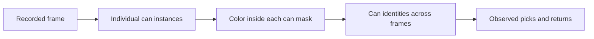

> Research note written October 15, before the model trials. Later choices and results are recorded in the [development history](../development-history.md). The models listed here were candidates, not the eventual deployed selection.

# Individual can detection: research and next experiment

October 15, 2026

We will treat the current HSV-and-contour counter as an unsuccessful baseline for normal grouped picks. The supplied Yards recording already shows merged cans, missed label regions, and false candidates from hands, clothing, and packaging. Better lighting and a fixed camera remain useful, but they do not give a connected-color-region detector a reliable way to separate touching cans. The [recorded-clip results](../../legacy/color_baseline/docs/recorded-clip-test.md) justify investigating a different detector now, while the wooden mockup is being built.

No learned detector has been tested on our recording yet. This note records the research and proposed experiment, not a successful V2 implementation. We have not started custom model training.

## What changes in the proposed pipeline

We will investigate instance segmentation: a model identifies each can and predicts a separate mask for its visible surface. Two adjacent cans can belong to different predicted instances even when their label pixels have the same color. This is a learned object assignment, rather than grouping every connected patch of matching pixels into one candidate. Mask quality and the number of instances still need to be tested on our footage.

A bounding-box detector is a simpler comparison, but a box around one tilted can can include another can, a hand, or the shirt. A useful instance mask should reduce that contamination before HSV classification. We should measure color only from sufficiently saturated label pixels, excluding silver tops and white printing. An insufficient visible label should produce an unknown color, not a forced classification.

A detector might establish a partly covered can from its visible body and context. It cannot verify a completely unobserved can simply because the recipe expects four. We must not hard-code four detections per grab or interpret one merged region as a known pair.

## Papers and their relevance

The proposed applications below are our interpretation of the research. None of these papers validates the Yards station or our target hardware.

| Primary source | What it establishes | How we would use it |
|---|---|---|
| Goldman et al., [Precise Detection in Densely Packed Scenes / SKU-110K](https://openaccess.thecvf.com/content_CVPR_2019/html/Goldman_Precise_Detection_in_Densely_Packed_Scenes_CVPR_2019_paper.html), CVPR 2019 | Detecting many nearby, similar products requires resolving individual objects and overlapping detections. | Treat touching cans as a dense object-detection problem. Shelf-image results do not establish performance on moving cans covered by hands. |
| He et al., [Mask R-CNN](https://arxiv.org/abs/1703.06870), ICCV 2017 | An instance-segmentation system predicts a separate object mask alongside localization and recognition. | Use the per-instance representation for color isolation. This is a foundational reference, not our proposed deployment model or speed benchmark. |
| Wang et al., [YOLOE: Real-Time Seeing Anything](https://arxiv.org/abs/2503.07465), ICCV 2025 | Detection and segmentation can be conditioned on text or visual examples, with an efficient architecture. | Try a can prompt on the supplied footage before creating a custom training set. Zero-shot failure would not rule out a fine-tuned can model. |
| Carion et al., [SAM 3: Segment Anything with Concepts](https://arxiv.org/abs/2511.16719), 2025 | Concept prompts can request object-instance masks and identities in images and videos. | Consider it as an offline reference or annotation aid if the first candidate fails. Its concept results are not evidence of real-time Raspberry Pi performance. |
| Zhang et al., [ByteTrack](https://arxiv.org/abs/2110.06864), ECCV 2022 | Lower-confidence detections can help preserve tracks through difficult observations. | Evaluate temporal association after the detector can separate cans. A tracker cannot manufacture four reliable instances from two merged detections. |
| Bodla et al., [Soft-NMS](https://arxiv.org/abs/1704.04503), ICCV 2017 | Suppressing overlapping boxes can remove genuine nearby objects; changing suppression can retain useful candidates. | Inspect duplicate-removal behavior when a learned detector misses a neighboring can. We should not disable deduplication blindly or assume this change solves the HSV merging problem. |

## Shortlist

### First offline experiment: YOLOE

Start with `yoloe-26s-seg.pt`, a text/visual-prompt segmentation checkpoint documented by [Ultralytics](https://docs.ultralytics.com/models/yoloe). Use a fixed prompt such as `beer can`, then inspect individual masks on the original clip. A separate visual-prompt experiment can use a clear reference can. Prompt choice must be recorded; selecting the best prompt after viewing a test sequence makes that sequence development data.

Begin with object identity only. Do not prompt for red, green, and blue separately or request an expected number of cans. That would confound object separation with the color classifier we are trying to evaluate. The model also needs testing against printed can pictures on packaging.

This experiment can proceed before the mockup is ready. It is a way to inspect a different representation of the existing footage, not a promise that a generic model will work without adaptation. Keep model packages and downloaded weights separate from the working OpenCV environment and calibration.

### Custom candidate: a small can-instance model

If the prompted model misses visible cans, fine-tune a compact segmentation checkpoint on a single `can` class. `yolo26n-seg.pt` is a starting candidate supported by the [official segmentation and training documentation](https://docs.ultralytics.com/tasks/segment). Its existing COCO weights initialize features; they are not already a validated beer-can model. The [COCO class list](https://raw.githubusercontent.com/ultralytics/ultralytics/main/ultralytics/cfg/datasets/coco.yaml) has bottle and cup categories but no dedicated can category.

Keeping the object class independent of label color lets us evaluate separation first and retain OpenCV for color classification. A box-only model should be compared if mask annotation or inference cost becomes impractical. We would then need to measure contamination inside each box explicitly.

We have not selected a production model. Published hardware benchmarks do not establish our latency. For example, the official YOLO26 segmentation table reports 53.3 ms CPU ONNX inference for its nano model at 640 pixels under its benchmark conditions, already longer than a 33 ms frame interval. That is neither our computer nor a Raspberry Pi measurement. Input crop, model size, export runtime, and hardware must be evaluated together. Our current HSV processing time cannot be reused as a learned-model timing result.

SAM 3 is an optional larger reference, not the default brewery deployment plan. Its [official repository](https://github.com/facebookresearch/sam3) requires checkpoint access and authentication. We would inspect those setup requirements before choosing it for an actual trial.

## How we would adapt and evaluate a model

1. **Define the object-level question.** Identify the actual visible can instances during each lift, including the two cans in each hand. Do not start by tuning the recipe counter to produce four.
2. **Build a small development review set from the recording.** Include the blue lift near 16.87 seconds, red near 22.87 seconds, green near 24.93 seconds, and the green sequence from 26 to 30 seconds. Include hands without picked cans, waiting inventory, carton handling, printed packaging, and colored clothing. Use source timestamps from sequential decoding.
3. **Run the prompted candidate and inspect all relevant frames.** Compare boxes and masks against manual instance labels, including misses, duplicate instances, and masks that combine neighboring cans. A few favorable still images are insufficient.
4. **Prepare custom labels if needed.** Annotate individual visible can masks consistently, including partially covered and rotated cans. Label all visible cans within the chosen training crop, including waiting stock; unlabeled real cans should not silently become background examples. Completely hidden instances should be marked as unobservable in the review record rather than assigned invented visible masks. Automatic masks require human correction.
5. **Separate development from evaluation.** Reserve whole pickup cycles, not randomly selected adjacent frames. The present clip is development evidence and offers limited diversity. Use new mockup and Yards recordings for independent testing across operators, angles, lighting, and grab sizes.
6. **Add color classification within each instance.** Measure correct color and unknown results separately. Carry a well-supported earlier color along a track when a later frame hides the label; do not turn uncertain pixels into a new can identity.
7. **Add temporal counting after separation works.** Match identities across frames and compare actual pick/return events. Frame-level detections alone do not establish distinct transfers or carton contents. Keep box placement as a separate observable event.
8. **Measure processing and workflow performance.** Record sustained throughput, latency distribution, missed events, duplicate events, exact grouped-pick counts, and review frequency on the intended hardware. An all-review system does not meet the automatic-verification goal.

An initial annotation effort should prioritize different poses and failure conditions over large numbers of nearly identical frames. We cannot establish a sufficient training-set size from this one clip. If a pilot model improves only the frames used for tuning, it has not established production feasibility.

## Decision for the project

Stop treating further color-threshold tuning as the main route to grouped-pick counting. Investigate can-instance detection and segmentation on the supplied recording now. Continue building the mockup in parallel so the new candidate can be evaluated under a controlled view and on fresh footage.

The next result we need is a side-by-side comparison of actual individual cans and the new model's instances over complete lifts. Custom training is a proposed subsequent step if zero-shot object separation is inadequate. The working webcam prototype remains available as the baseline, and no learned-model success is claimed yet.
