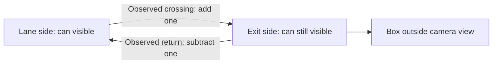

> Historical baseline note. For the current implementation, see the [vision overview](../../../README.md) and [development history](../../../docs/development-history.md).

# Choosing the camera approach

We are starting with color detection and observed crossings of a fixed boundary. This keeps the box outside the image and gives us a concrete event to test: a can moves from the lane side into a visible exit area. A return moves in the opposite direction.

Our [October 15 prototype direction](../../../../docs/design/prototype-direction.md) records the physical test: a wooden lane mockup, twelve cans, and a camera opposite the employee with the carton opening included where practical. The [recorded-clip experiment](recorded-clip-test.md) has already shown that the color-region baseline does not reliably count grouped picks. We will investigate [individual-can detection and segmentation](../../../docs/history/instance-detection-20261015.md) on the existing footage while building the mockup. No learned model has been tested on our footage yet.

| Approach | What we need to observe | Main tradeoff |
|---|---|---|
| Live picks and returns | Each can visible on both sides of an internal boundary | Fits the existing picking process, but hands and grouped picks can interrupt tracking. |
| Count cans that disappear from a lane | A reliable explanation for every disappearance | An occluding hand, conveyor movement, and a real pick can look alike. Disappearance alone is insufficient. |
| Inspect a staged group | All selected cans visible and separated in one quiet image | Easier to check the current mix, but adds a staging step for workers. |

The live approach is our preferred first experiment. Whether it is suitable for the actual station depends on how much of the transfer the camera can see during normal work. If a hand covers the whole transfer, changing tracking software cannot recover the missing visual evidence. We would need a better camera angle, another sensor or camera, or a staged check.

## Counting boundary

The boundary must sit inside the image, with a strip of visible space beyond it. It can be horizontal, vertical, or angled. It represents movement in the image, so a higher or lower pixel position does not necessarily mean a can physically moved up or down.

We confirm a side over several frames and leave a small neutral band around the line. This prevents small tracking changes near the line from repeatedly adding and subtracting a can. The tracker uses color and nearby motion to associate detections. A pick requires a confirmed lane side followed by a confirmed exit side. Disappearance does not add anything.

An optional transfer band limits where new tracks start. We use it to keep waiting inventory and cans already carried beyond the crossing out of the tracking problem. A matched can that visibly leaves the band on its confirmed side can be retired without a warning or a count change. A can disappearing inside the band before a confirmed exit still needs review. We keep the color masks over the full inspection area rather than clipping them at the band edges, which could split a label or change its measured area.

A can can leave the image and later return with a new track ID. An observed exit-to-lane crossing then subtracts from the current color total. This assumes the operator returns a can from the current carton. Color alone cannot prove that identity. We must finish one carton before starting the next.

## Why HSV and contours first

The cans have distinct red, green, and blue labels, so we can start with a method that is easy to inspect and calibrate. OpenCV's HSV representation separates hue from saturation and brightness. We threshold each color, reject low-saturation reflections, and use two ranges when red wraps around the ends of the hue scale. This follows OpenCV's [HSV thresholding guidance](https://docs.opencv.org/4.13.0/da/d97/tutorial_threshold_inRange.html).

We clean small mask noise and use connected outlines to locate colored regions, following OpenCV's [contour workflow](https://docs.opencv.org/4.13.0/d4/d73/tutorial_py_contours_begin.html). Minimum and maximum colored area help exclude tiny marks and large background patches. These regions are candidates, not a trained can detector. The camera angle, background, label rotation, and highlights still matter.

HSV reduces some brightness sensitivity, but it does not make color recognition lighting-independent. We should use consistent lighting, avoid blown-out highlights, and calibrate under the conditions we will actually test. A blue shirt or similarly colored object in the inspection area can still look like a candidate.

## Tracking and uncertainty

The initial tracker predicts nearby motion and associates candidates of the same color. It is intentionally small enough for us to inspect while testing. It blocks questionable events when existing tracks merge, associations are close, a crossing has too large a detection gap, or a track disappears before an observed exit. Warnings require a manual review before the display can show READY.

A warning only covers evidence the program actually saw. A fully hidden can, or two touching cans that appear as one region from the beginning, may still be missed. We cannot treat the absence of a warning as proof of a correct carton.

Established alternatives include [SORT](https://arxiv.org/abs/1602.00763), which combines motion estimation with assignment, and [ByteTrack](https://arxiv.org/abs/2110.06864), which uses lower-confidence detections to help maintain tracks. Our current tracker is not an implementation of either method. They are possible upgrades if recordings show association failures that better tracking could resolve. A trained can detector could also help separate label fragments and colored background objects; it would need representative images and evaluation.

## What we need to establish next

The initial bench tests established visible single-can picks and returns. The next detector experiment should address individual can instances during grouped picks on the supplied recording. Once those instances can be established, we can evaluate color classification and temporal counting. We compare every logged event against the footage and manually count the resulting mix. The [test plan](testing.md) includes conditions that should force a review as well as cases where the method may miss a can entirely.

The mockup will provide controlled camera tests and fresh footage for the new candidate. Completely unobservable transfers still require a different view, another source of evidence, or a changed workflow. Once the method works under representative conditions, we can add lane-specific expectations, stack-light outputs, and the operator interface.
